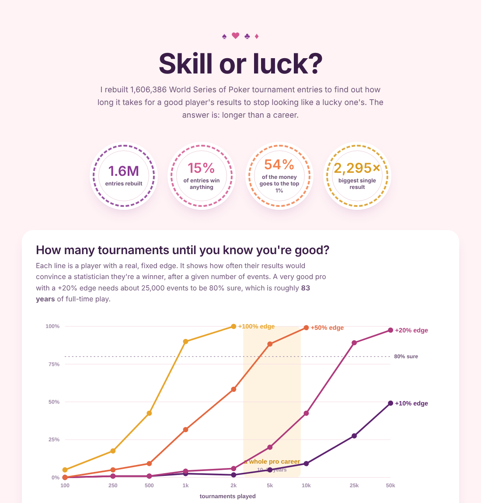

# Skill or luck? Tournament poker, measured like a fund

How many tournaments does a winning player need before their results stop
looking like a lucky player's? I rebuilt 1.6 million live World Series of
Poker entries to find out. The answer is: longer than a career.



## What it found

**A very good professional cannot prove it from results.** A player with a
genuine +20% return on investment needs around 25,000 live events before a
95%-confidence test recognises them as a winner 80% of the time. At 300
events a year, that is over 80 years. A +10% player does not get there
inside 50,000 events.

**Skill is still real and measurable.** The data records only cashes, so no
player's profit is knowable — but how deep a player runs when they do cash
is observable. Splitting each player's cashes into alternating halves, depth
in one half predicts depth in the other: r = 0.10 at 10+ cashes, rising to
0.28 at 40+. With depths shuffled across players, the same test gives ~0.00.

**Both are true at once because the payouts are so top-heavy.** Only 15% of
entries cash at all, the median cash is 2.2 buy-ins, and the top 1% of
entries take 54% of all prize money. Skill shifts the odds of a deep run; it
cannot make one happen often enough to show up in a lifetime of results.

**Sizing your buy-in to your results is a bet on a hot streak.** On the real
payout distribution, Kelly sizing at a *known* +20% edge stakes about 0.24%
of bankroll per event — a 400-buy-in roll. And since no player knows their
edge, the calculator shrinks a record toward the field average by however
much its sample size deserves. A counterintuitive consequence: at a fixed
number of events, *better*-looking results earn *less* trust, because
extreme records are more likely to be streaks.

This is the same problem as judging a fund manager on a short track record,
and the same tools apply: bootstrap intervals instead of normal theory,
one-sided tests, shrinkage, and Kelly under parameter uncertainty.

## The hard part: the data only shows winners

The source lists who cashed, not who entered. That rules out per-player ROI
entirely — anyone's losing entries are invisible — so this project never
reports one.

What it does instead is rebuild each event's full field size two independent
ways and keep only the events where they agree:

- from the prize pool: `entrants = prize_pool / (buy_in × 0.92)`
- from places paid: `entrants = cashers / 0.15`

| Check | Rebuilt | Actual |
|---|---|---|
| 2024 Main Event | 10,113 (from places paid) | 10,112 |
| 2023 Main Event | 10,047 | 10,043 |
| 2022 Main Event | 8,580 | 8,663 |

2,338 of 9,958 events pass. With field sizes known, every non-cashing entry
can be added back as a zero, which gives the real per-entry outcome
distribution the statistics run on. The field's overall return comes out at
−8.4%, roughly the house's cut — a number the reconstruction was never told.

## Limits worth knowing

- **Live events only.** Online events pay a different share of the field and
  almost all fail the cross-check.
- **Players are matched by name.** Two people sharing a name are merged;
  3,293 names appear under more than one home country.
- **Deep-run consistency may partly reflect event selection** — which
  tournaments someone plays — and not only how well they play. Depth is
  normalised by the number paid, which helps but does not fully control it.
- **The calculator's prior** (field-average edge, ±25% spread) is an
  assumption, not something the data measures.

## How it is built

Python and PostgreSQL, in three layers:

```
raw        the CSVs exactly as published, all text, never modified
core       typed tables: series, events, players, results
analysis   views: field reconstruction, the cross-check filter,
           outcome distribution, careers, split-half skill test
```

```
sql/01_schema.sql      tables and constraints
sql/02_transform.sql   parsing rules (buy-ins, money, name keys)
sql/03_analysis.sql    field reconstruction and outcome distribution
sql/04_careers.sql     player-level views and the skill test
src/load.py            bulk-loads the CSVs with COPY, runs the SQL
src/variance.py        bootstrap intervals, power by sample size, FDR
src/kelly.py           Kelly sizing, shrinkage, drawdown simulation
src/simulate.py        produces the power curves (a few minutes)
src/dashboard.py       renders reports/dashboard.html
```

## Running it

```bash
brew install postgresql@16 && brew services start postgresql@16
createdb poker

python3 -m venv .venv && source .venv/bin/activate
pip install -r requirements.txt

# dataset: https://zenodo.org/records/15556775  (data.zip, 573 MB)
mkdir -p data/raw && cd data/raw
curl -L -o data.zip "https://zenodo.org/records/15556775/files/data.zip?download=1"
unzip data.zip -d unpacked && cd ../..

python src/load.py        # ~30 s
python src/simulate.py    # ~4 min
python src/dashboard.py
open reports/dashboard.html
```

Set `DATABASE_URL` to use a database other than the local `poker`.

## Data

*A Dataset of Poker Tournaments* (Zenodo, 2025), licensed CC BY 4.0. Raw
files are not included in this repository; the commands above fetch them.
